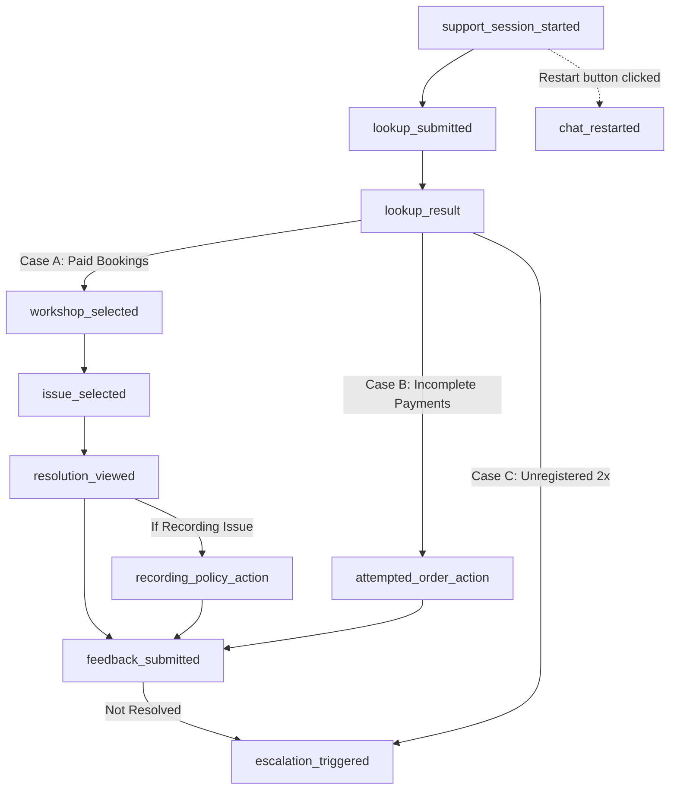

# Creator Labs Support — Mixpanel Analytics Tracking Dictionary

This document details all **Mixpanel Events**, **Properties**, **Allowed Values**, and **Business Logic** implemented in the Creator Labs Support Assistant.

---

## 🧭 End-to-End User Journey Funnel

---

## 🌐 Global / Super Properties (Attached to Every Event)

Once the user enters their phone number or email, Mixpanel calls `mixpanel.identify()` and registers these **Super Properties**. They are automatically attached to every subsequent event in the session:

| Property Name | Data Type | Example Value | Meaning & Possible Values |
| :--- | :--- | :--- | :--- |
| `user_identifier` | String | `9876543210` or `rahul@gmail.com` | The raw phone number or email entered by the user. Also serves as Mixpanel's **Distinct ID**. |
| `identifier_type` | String | `phone` | Type of credential used. Values: `'phone'` \| `'email'`. |
| `phone_number` | String | `9876543210` | Attendee's 10-digit mobile number (if searched via phone or matched in booking record). |
| `phone` | String | `9876543210` | Standard reporting alias for `phone_number`. |
| `email` | String | `rahul@gmail.com` | Attendee's email address (if searched via email or matched in booking record). |

---

## 📋 Comprehensive Events & Properties Dictionary

### 1. `support_session_started`
* **Triggering Logic**: Fires once when the attendee opens the support web page.
* **Purpose**: Measures top-of-funnel traffic and device distribution.

| Property Name | Data Type | Example Value | Meaning & Possible Values |
| :--- | :--- | :--- | :--- |
| `referrer` | String | `https://creatorlabs.in/` | The referring URL or landing page where the user came from (`document.referrer`). |
| `device_type` | String | `mobile` | Device category detected via viewport width: `'mobile'` (≤768px) or `'desktop'`. |
| `url` | String | `/support` | Current URL path of the support portal. |

---

### 2. `lookup_submitted`
* **Triggering Logic**: Fires when the user types their phone number or email and clicks **Send** / presses **Enter**.
* **Purpose**: Tracks search intent and input validation.

| Property Name | Data Type | Example Value | Meaning & Possible Values |
| :--- | :--- | :--- | :--- |
| `user_identifier` | String | `8949219529` | Sanitized phone number or email being queried. |
| `identifier_type` | String | `phone` | Format detected: `'phone'` (10 digits) or `'email'` (contains `@`). |
| `attempt_number` | Number | `1` | Search attempt count: `1` for initial search; `2` for retry after not found. |
| `char_length` | Number | `10` | Number of characters in the entered search string. |

---

### 3. `lookup_result`
* **Triggering Logic**: Fires when the MongoDB/Redis lookup API responds with attendee details.
* **Purpose**: Measures lookup success rate, funnel segmentation, and attendee payment history.

| Property Name | Data Type | Example Value | Meaning & Possible Values |
| :--- | :--- | :--- | :--- |
| `case_type` | String | `CASE_A` | High-level outcome category:  • `'CASE_A'`: 1+ confirmed paid workshops found. • `'CASE_B'`: No paid orders, but incomplete/failed payment attempts found. • `'CASE_C'`: No records found in the database. |
| `outcome` | String | `CASE_A_PAID` | Granular outcome key: `'CASE_A_PAID'` \| `'CASE_B_ATTEMPTED'` \| `'CASE_C_NOT_FOUND'`. |
| `workshops_count` | Number | `2` | Number of paid workshops found (Case A) or number of failed attempts (Case B). |
| `unique_domains_count` | Number | `1` | Count of distinct creator domains associated with this user. |
| `domains_list` | List [String] | `["growthcoach.creatorlabs.in"]` | Array of all creator landing page domains found for this user. |
| `primary_domain` | String | `growthcoach.creatorlabs.in` | Domain of the most recent booking or checkout attempt. |
| `total_paid_value` | Number | `499` | *(Case A only)* Total INR value of all confirmed paid registrations. |
| `attempts_count` | Number | `12` | *(Case B only)* Total number of failed payment attempts. |
| `total_attempted_value`| Number | `2499` | *(Case B only)* Total INR value across all failed payment attempts. |
| `attempt_number` | Number | `1` | *(Case C only)* Search attempt number (`1` or `2`). |
| `is_cached` | Boolean | `false` | Whether the lookup response was served from Redis cache (60s TTL). |

---

### 4. `workshop_selected`
* **Triggering Logic**: Fires when the user taps one workshop card from their registrations list (or auto-selected if only 1 active workshop is found).
* **Purpose**: Identifies which specific workshop/creator the attendee needs help with.

| Property Name | Data Type | Example Value | Meaning & Possible Values |
| :--- | :--- | :--- | :--- |
| `domain` | String | `growthcoach.creatorlabs.in` | The specific landing page domain of the workshop. |
| `brand_name` | String | `Growth Coach Sandeep` | Brand / workshop title displayed on the ticket. |
| `creator_name` | String | `Sandeep` | Name of the host or creator. |
| `amount` | Number | `499` | Registration amount paid by the attendee in INR. |
| `status_category` | String | `UPCOMING` | Timing stage of the workshop:  • `'LIVE_NOW'`: Session currently underway. • `'UPCOMING'`: Future scheduled date. • `'COMPLETED'`: Past workshop session. • `'UNDATED'`: Start date not specified in notes. |
| `has_workshop_date` | Boolean | `true` | `true` if workshop date/time was extracted from notes; `false` otherwise. |
| `has_community_link` | Boolean | `true` | `true` if an official WhatsApp community group URL is configured for this creator. |

---

### 5. `issue_selected`
* **Triggering Logic**: Fires immediately when the attendee taps an issue button.
* **Purpose**: Identifies the primary customer pain point and support inquiry reason.

| Property Name | Data Type | Example Value | Meaning & Possible Values |
| :--- | :--- | :--- | :--- |
| `issue_key` | String | `ZOOM_LINK` | Standardized internal issue code:  • `'ZOOM_LINK'`: Where is Zoom link / how to join. • `'WA_COMMUNITY'`: Need WhatsApp community link. • `'WANT_REFUND'`: Refund / cancellation inquiry. • `'RECORDING_REQUEST'`: Wants video recording access. • `'MISSED_WORKSHOP'`: Missed session / what to do. • `'CHANGE_TIMING'`: Rescheduling to next batch. • `'COURSE_ACCESS'`: LMS / bonus course access. • `'SOMETHING_ELSE'`: Other / custom query. |
| `issue_label` | String | `Where can I get the Zoom link?` | Exact button label text shown to the user. |
| `domain` | String | `growthcoach.creatorlabs.in` | Workshop domain associated with the inquiry. |
| `brand_name` | String | `Growth Coach Sandeep` | Brand name of the workshop. |
| `status_category` | String | `UPCOMING` | Timing status of the workshop (`UPCOMING`, `LIVE_NOW`, `COMPLETED`, `UNDATED`). |

---

### 6. `resolution_viewed`
* **Triggering Logic**: Fires 600ms after `issue_selected` when the bot's automated answer message renders in the chat.
* **Purpose**: Tracks self-service resolution delivery and CTA engagement.

| Property Name | Data Type | Example Value | Meaning & Possible Values |
| :--- | :--- | :--- | :--- |
| `issue_key` | String | `ZOOM_LINK` | The issue key being resolved. |
| `domain` | String | `growthcoach.creatorlabs.in` | Workshop domain. |
| `brand_name` | String | `Growth Coach Sandeep` | Workshop brand name. |
| `has_cta` | Boolean | `true` | Whether the resolution provides an actionable external button. |
| `cta_type` | String | `whatsapp_community` | Type of CTA button presented:  • `'whatsapp_community'`: Direct invite link to WhatsApp group. • `'creator_contact'`: Creator's official support email / phone. • `'none'`: Informational text resolution only. |

---

### 7. `recording_policy_action`
* **Triggering Logic**: Fires when the attendee responds to the workshop recording policy card.
* **Purpose**: Measures policy understanding vs. creator dispute claims.

| Property Name | Data Type | Example Value | Meaning & Possible Values |
| :--- | :--- | :--- | :--- |
| `choice` | String | `understood` | User's response:  • `'understood'`: Attendee clicked "Understood, thank you". • `'creator_promised'`: Attendee clicked "The creator told me recording will be provided". |
| `domain` | String | `growthcoach.creatorlabs.in` | Workshop domain. |
| `brand_name` | String | `Growth Coach Sandeep` | Workshop brand name. |
| `creator_name` | String | `Sandeep` | Creator name. |

---

### 8. `feedback_submitted`
* **Triggering Logic**: Fires when attendee answers *"Did this solve your problem?"* (Yes / No).
* **Purpose**: Core CSAT / self-service resolution rate KPI.

| Property Name | Data Type | Example Value | Meaning & Possible Values |
| :--- | :--- | :--- | :--- |
| `resolved` | Boolean | `true` | `true` if clicked "Yes, this solved my problem"; `false` if clicked "No, I need more help". |
| `flow_context` | String | `paid_workshop_resolution` | The flow origin:  • `'paid_workshop_resolution'`: Completed Case A issue resolution. • `'attempted_orders_recovery'`: Viewed Case B incomplete payment guidance. |
| `issue_key` | String | `ZOOM_LINK` | The specific issue being evaluated (or `'payment_not_completed'` for Case B). |
| `domain` | String | `growthcoach.creatorlabs.in` | *(Case A)* Workshop domain. |
| `brand_name` | String | `Growth Coach Sandeep` | *(Case A)* Workshop brand name. |
| `amount` | Number | `499` | *(Case A)* Workshop registration amount. |
| `status_category` | String | `UPCOMING` | *(Case A)* Workshop timing stage. |
| `primary_domain` | String | `growthcoach.creatorlabs.in` | *(Case B)* Domain of the primary failed attempt. |
| `domains_list` | List [String] | `["growthcoach.creatorlabs.in"]` | *(Case B)* All domains with incomplete checkouts. |
| `attempts_count` | Number | `12` | *(Case B)* Number of failed payment attempts. |
| `total_attempted_value`| Number | `2499` | *(Case B)* Total value of failed attempts in INR. |

---

### 9. `escalation_triggered`
* **Triggering Logic**: Fires when the attendee is directed to WhatsApp human agent support.
* **Purpose**: Measures bot escalation rate, agent workload, and unresolved inquiry drivers.

| Property Name | Data Type | Example Value | Meaning & Possible Values |
| :--- | :--- | :--- | :--- |
| `reason` | String | `Needs further assistance` | Trigger cause:  • `'Needs further assistance'`: Clicked "No, I need more help" on feedback. • `'Wants to talk to human agent'`: Explicitly requested an agent. • `'Registration not found after phone and email search'`: Case C failed twice. |
| `domain` | String | `growthcoach.creatorlabs.in` | Associated workshop domain (or `'none'` if unregistered search). |
| `brand_name` | String | `Growth Coach Sandeep` | Associated brand name (or `'none'` if unregistered search). |
| `had_workshop` | Boolean | `true` | Whether the user was matched to an active workshop registration. |
| `flow_context` | String | `paid_workshop` | Origin context: `'paid_workshop'` \| `'attempted_order'` \| `'unregistered_search'`. |

---

### 10. `attempted_order_action`
* **Triggering Logic**: Fires when an attendee with an incomplete payment clicks **Complete Registration** on a failed checkout card.
* **Purpose**: Tracks drop-off payment recovery conversions and checkout click-through rate.

| Property Name | Data Type | Example Value | Meaning & Possible Values |
| :--- | :--- | :--- | :--- |
| `action` | String | `click_complete_registration` | The action taken by the attendee. |
| `domain` | String | `growthcoach.creatorlabs.in` | Exact creator domain of the attempted checkout. |
| `brand_name` | String | `Growth Coach Sandeep` | Workshop brand name. |
| `amount` | Number | `499` | Incomplete checkout amount in INR. |
| `order_id_masked` | String | `order_Pw8...z89` | Razorpay order ID (masked for security). |
| `attempt_date` | String | `26 Oct 2026, 04:30 PM` | Formatted timestamp of the payment attempt. |
| `card_position_in_list`| Number | `1` | 1-based index position of the card clicked (e.g. 1st out of 12 attempts). |
| `total_user_attempts` | Number | `12` | Total count of incomplete checkout attempts the user has. |

---

### 11. `chat_restarted`
* **Triggering Logic**: Fires when attendee clicks the **Restart Chat** button in the header.
* **Purpose**: Tracks session resets, navigation resets, and multi-issue resolution behaviors.

| Property Name | Data Type | Example Value | Meaning & Possible Values |
| :--- | :--- | :--- | :--- |
| `step_at_restart` | String | `RESOLUTION_CTA` | The workflow step the attendee was on when restarting (`WELCOME`, `WORKSHOPS_LIST`, `ISSUE_SELECT`, `RESOLUTION_CTA`, `ATTEMPTED_LIST`, `NOT_FOUND_FIRST`, `SUCCESS_CLOSING`, `ESCALATION`). |
| `had_selected_workshop`| Boolean | `true` | `true` if the user had already picked a workshop before restarting. |
| `had_completed_flow` | Boolean | `false` | `true` if user had reached final feedback or escalation before restarting. |
